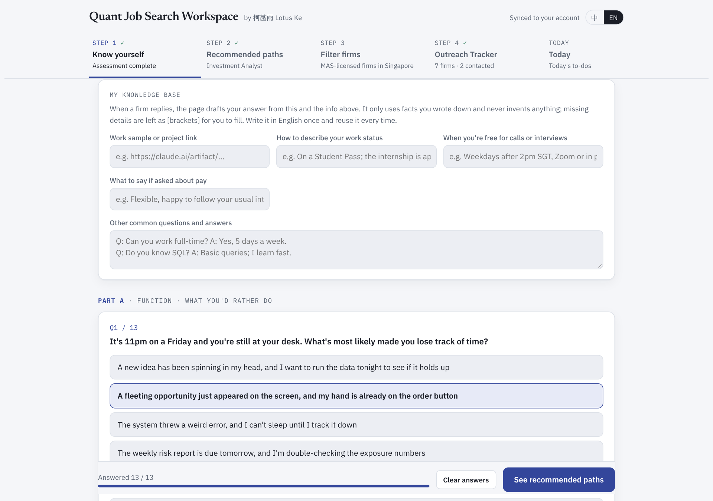
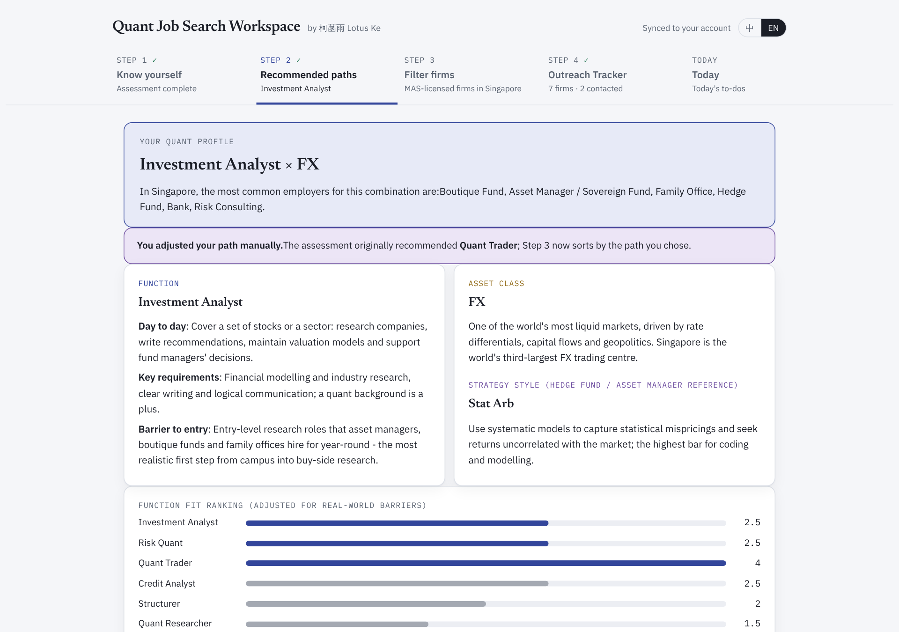
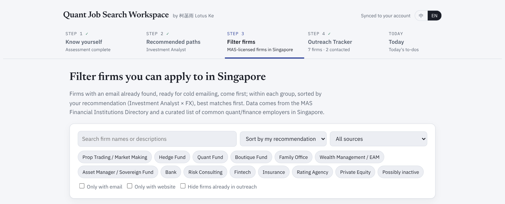
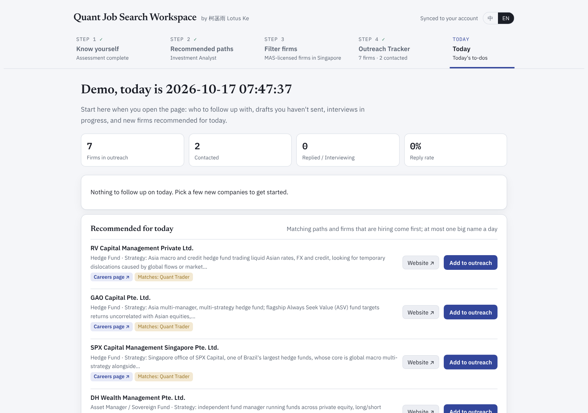

# Quant Job Search Workspace

A web app that helps quantitative-finance students in Singapore work out **which role suits them**, **which firms actually hire for it**, and **what to do today** to move their search forward.

I built it for my own internship search, then shaped it into a tool other students can use. It is bilingual (English / Chinese) and runs in the browser with data synced to the user's account.

> Source code is private while the app is being developed into a product. This repository documents the design and shows screenshots.

## The problem

"Quant" covers very different jobs: trading, research, risk, structuring, investment analysis. Students tend to apply to the same few big banks and hedge funds, while hundreds of smaller MAS-licensed managers in Singapore hire quietly and are rarely contacted. There is no single place that maps those firms by strategy and tells a student where they realistically fit.

## What it does

**1. Know yourself.** A short scenario-based assessment ("It's 11pm on a Friday and you're still at your desk. What made you lose track of time?") plus an optional CV upload. Answers map to front-, middle- and back-office functions, asset classes and strategy styles.

**2. Recommended paths.** Scores are adjusted for real-world barriers to entry, so a student is not pointed only at the most competitive roles. The page explains each path's day-to-day work and requirements, and suggests adjacent tracks that are easier to break into.

**3. Firm database.** 460+ Singapore firms, filterable by type (hedge fund, family office, prop trading, asset manager…) and ranked by fit with the student's path. Researched firms carry a structured profile of what they do and who they hire.

**4. Today.** A daily page: who to follow up with, interviews coming up, and a few new firms to look at today, chosen to match the student's path.

It also keeps an application tracker and a personal knowledge base (work samples, availability, standard answers) that the app uses to draft replies to recruiters. Every message is a draft for the student to review and send; the app never sends anything on its own.

## How it is built

- Single-page web app in plain HTML, CSS and JavaScript, bilingual (English / Chinese) from one source.
- Firm data compiled from public sources, including the MAS Financial Institutions Directory.
- A scoring model turns assessment answers into a ranked list of roles and firms, weighing fit against how hard each role is to break into.
- Built with AI coding tools, with every feature tested in a headless browser at desktop and phone widths.

## Status

In active use for my own search (October 2026).

---

© 2026 柯菡雨 Hanyu (Lotus) Ke. All rights reserved. Screenshots show demo data.
[LinkedIn](https://www.linkedin.com/in/hanyu-ke-lotus)
